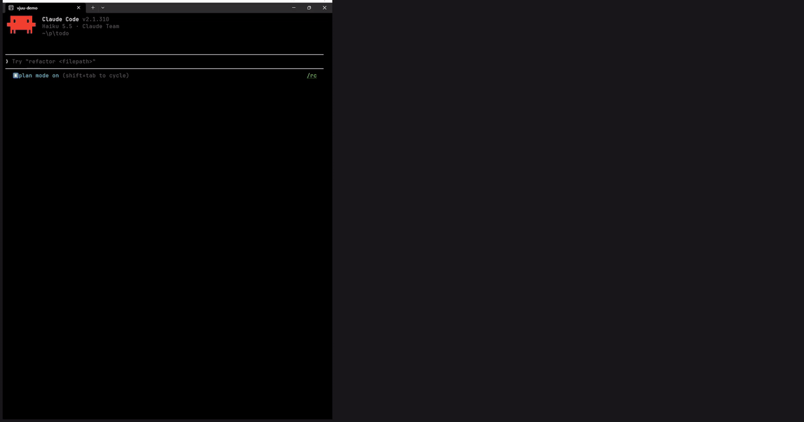
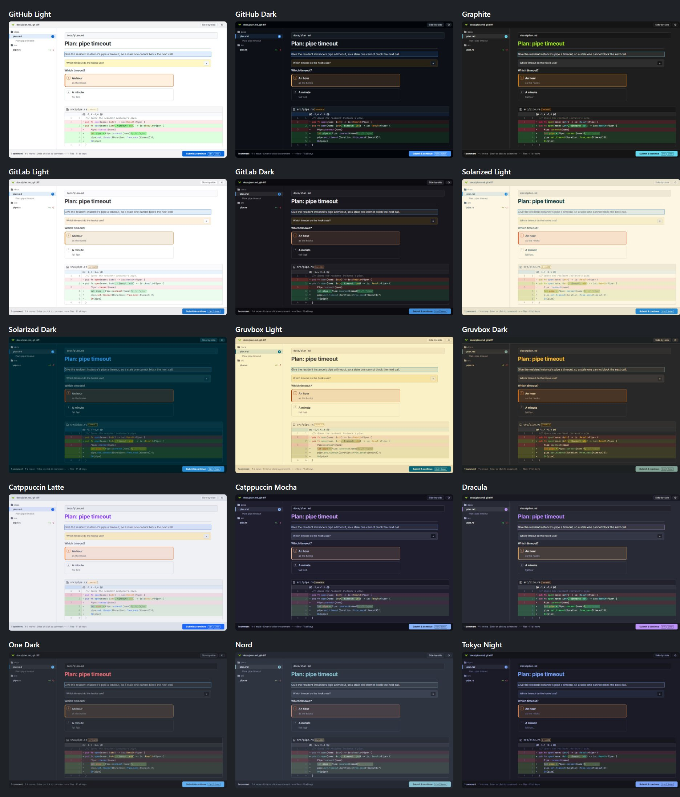

# [vjuu](https://vjuu.it)

[](https://github.com/kimvais/vjuu/actions/workflows/ci.yml)
[](https://github.com/kimvais/vjuu/releases/latest)
[](https://crates.io/crates/vjuu)
[](LICENSE)
[](#install)

A fast review window for agent handoffs. When an agent would say "open X and review it", it runs
`vjuu X` instead: a window opens with the markdown or diff, you comment on lines, click **Submit & continue**, and
your comments come back to the agent as markdown on stdout, anchored to `file:line`.

[](https://www.youtube.com/watch?v=EqzmtuNQzv4)

## Install

Runs on Windows 10/11 (WebView2), Linux (WebKitGTK 4.1: Debian 12+, Ubuntu 22.04+) and macOS (WKWebView). On
Windows the window is frameless with its own title bar; macOS and Linux keep the native frame. macOS builds are
compiled and tested in CI but not by hand.

### Windows

```
winget install vjuu
```

Not yet: the [winget package](https://github.com/microsoft/winget-pkgs/pull/460998) is waiting for Microsoft's
approval. Until then, use cargo or a `.zip` (below).

### macOS

```
brew install kimvais/tap/vjuu
```

Not signed or notarised. Homebrew installs work as is; a binary downloaded by hand needs
`xattr -d com.apple.quarantine vjuu` once.

### Debian, Ubuntu

```
curl -fsSL https://vjuu.it/apt/vjuu.gpg | sudo tee /usr/share/keyrings/vjuu.gpg >/dev/null
echo "deb [signed-by=/usr/share/keyrings/vjuu.gpg] https://vjuu.it/apt stable main" | sudo tee /etc/apt/sources.list.d/vjuu.list
sudo apt update && sudo apt install vjuu
```

### Anything else

```
cargo install --locked vjuu
```

Or a `.zip`, `.tar.gz` or `.deb` from [GitHub Releases](https://github.com/kimvais/vjuu/releases). Building needs a
Rust toolchain, and on Linux also `libwebkit2gtk-4.1-dev` and `libgtk-3-dev`.

### Then

However you installed it:

```
vjuu setup
```

It installs the `vjuu` skill, which tells agents to run `vjuu` in the background instead of asking you to open
files, for Claude Code (`~/.claude/skills`) and Codex (`~/.agents/skills`), whichever you have. Run it again after
an upgrade. The skill is also a Claude Code plugin (`claude plugin install vjuu@vjuu` after
`claude plugin marketplace add kimvais/vjuu`); use one or the other, not both.

## Usage

| Command | What it does |
|---|---|
| `vjuu docs/design.md` | markdown |
| `vjuu a.md b.md change.diff` | several files in one window, stacked |
| `vjuu change.diff` | diff or patch file |
| `vjuu site/index.html` | HTML page or claude.ai artifact, rendered as it looks once loaded; `file://` URLs work too |
| `vjuu src/main.rs` | any other file: line-numbered, syntax-highlighted source |
| `vjuu --git main...HEAD` | runs `git diff main...HEAD` in the current directory |
| `git show HEAD \| vjuu -` | stdin; diff or markdown is detected |
| `vjuu --session "fix login" plan.md` | name the asking session in the title bar (automatic under Claude Code) |
| `vjuu last` | print the most recent review again |
| `vjuu start` | start the resident instance in the tray, e.g. at login; double-clicking `vjuu.exe` does the same |
| `vjuu stop` | stop the resident instance (before upgrading the exe) |
| `vjuu setup` | install the skill for Claude Code and Codex |
| `vjuu config` | settings: which Claude Code hooks open vjuu (see below) |
| `vjuu --help`, `vjuu --version` | all of the above, briefly; the version |

`vjuu` blocks until you click **Submit & continue** or close the window. Every review is also saved to
`%LOCALAPPDATA%\vjuu\reviews\`, so a later session can pick it up with `vjuu last`.

## Why it opens fast

The first `vjuu` opens its window itself (~400 ms, mostly WebView2 starting) and starts a hidden
resident instance that keeps a pre-warmed window. Later calls hand the document to it over a named
pipe and the window appears almost at once. The spare window preloads fonts and renderers. The resident instance costs roughly 300 MB working set across
its WebView2 processes; `vjuu stop` ends it. `VJUU_COLD=1` skips it.

The resident instance has a tray icon. An orange dot on it means a review window is still open, and hovering it says
how many. Click it to bring the oldest one forward; right-click it for the settings, or to stop vjuu. If a new window
opens behind others (Windows refuses to hand over focus while you type elsewhere), a notification says so. Switch the
icon and notifications off with `vjuu config tray off`. On Linux the icon needs a desktop that shows StatusNotifier
icons (KDE, or GNOME with the AppIndicator extension).

A new window comes to the front and takes the keyboard. If that interrupts you, `vjuu config focus off` (or "Bring
new windows to the front" in the settings) opens new reviews behind the window you are in instead, each with a
notification when the tray is on.

| Case | First paint |
|------|-------------|
| Markdown or diff, cold | ~400-450 ms |
| Markdown, resident | ~15 ms |
| 6,600-line diff, resident | ~100-130 ms (highlighting runs after paint) |

## Keys

| Key | Action |
|-----|--------|
| `↑` / `↓` (or `k` / `j`) | Previous / next line or block |
| `←` / `→` (or `p` / `n`) | Previous / next file; with a single markdown file, previous / next heading |
| `Enter` (or `c`) | Comment on the current line, or on the selected text |
| `Ctrl+Enter` | In a comment: save it. In the settings: **Apply**. Anywhere else: **Submit & continue** |
| `Esc` | Cancel the comment being written; close the settings or the help |
| `1`–`9` | Pick that option of the choice block under the cursor (or of the only one); again to take it back |
| `v` | Toggle unified / side-by-side diff |
| `f` | Hide / show the sidebar (file list, or table of contents for markdown) |
| `Ctrl+,` (`⌘,` on macOS) | Settings |
| `Ctrl+Shift+Enter` | Submit & continue, from anywhere |
| `F1` | Help: the version and these keys |

Click any line or block to comment on it. To comment on a range, select text (across lines, paragraphs or diff
rows) and click **Comment** or press `c`. Links still open, except on HTML pages, where only in-page links work; clicks
inside a comment edit it.

Themes, picked in the settings (`Ctrl+,`, or the gear in the title bar): **Light** (GitHub) and **Graphite** (Monokai code colours on
neutral dark grey), GitHub Dark, GitLab Light and Dark, Dracula, One Dark, Nord, Tokyo Night, Solarized, Gruvbox and
Catppuccin (each light and dark), or any theme of your own. **Auto**, the default, follows the system: one theme while it is light,
another while it is dark, and the dark one when the system does not say. Picking previews the theme; **Apply** keeps it. See [Themes](#themes) to make your own.



## Output

```
# Review: docs/design.md (2 comments)

## docs/design.md:12-14
> quoted source lines

The comment.

## Overall
General comment, if any.
```

Deleted diff lines are marked `(old)` and use the old file's line number. A rendered HTML page has no line numbers:
its comments quote the text and say where it is, as `## site/index.html (#install)` (the nearest id) or
`## site/index.html (under "Install")` (the nearest heading).

### Choices

A ```` ```choice ```` block in a markdown document shows its list items as buttons; the other lines are the question.
Text before the first `: ` is the label, the rest an explanation. Click a button or press its digit to pick it, and do
it again to take the pick back. Picks come first in the review:

````
```choice
How should vjuu handle artifacts?
1. Snapshot (recommended): small change, one frozen state
2. Live page: interactive, much bigger
```
````

```
## Choice: How should vjuu handle artifacts?
Snapshot (recommended)
```

An unanswered choice reads `No answer.`

## Claude Code hooks

The vjuu plugin also hooks into Claude Code, so a few moments open in vjuu by themselves. All four are on by default.
The first vjuu window after a fresh install opens on the settings panel, where you can switch each one off.

**Plan review.** When Claude finishes a plan in plan mode, the plan opens in vjuu. Comment on it and click **Submit & continue**, and
Claude revises the plan and asks again. A comment that asks for nothing ("LGTM") just brings the plan back once more.
Click **Submit & continue** without comments, or close the window, and Claude Code's own approval prompt follows as usual. That
prompt is where you choose how Claude continues.

**Questions.** When Claude asks you something (its `AskUserQuestion` tool), the questions open in vjuu as buttons,
under the message that led to them. Pick an answer to each and click **Submit & continue**, and they go to Claude as if picked in the
terminal. Comment anywhere, or leave a question unanswered, and Claude gets your picks and comments to read instead, so
you can answer in your own words. Nothing times out. Close the window without picking, and Claude Code's own picker
asks. Questions that take several answers stay in that picker, as vjuu's buttons pick one.

**Turn review.** When Claude finishes a turn in which it edited files, the diff of those files opens in vjuu, new files
included. Comment and click **Submit & continue**, and Claude acts on your comments straight away. Click **Submit & continue** without comments
and the turn ends. Turns without edits, edits outside the git repository, and a diff you already reviewed open
nothing. The diff is the files'
uncommitted changes, so changes an earlier turn made to the same files show too.

**Permission prompts.** When Claude Code would ask whether Claude may run a command, edit a file or use another tool,
the request opens in vjuu: the command in full, the edit as a diff. Pick **Allow**, **Always allow** (Claude Code's
suggested rule, such as every `npm test` from now on) or **Deny**. Comment without a pick, and it is denied with your
comment as the reason, so Claude can try another way; a comment next to **Allow** does not reach Claude. Close the
window without picking, and Claude Code's own prompt asks. Plans and questions keep their own windows.

Each hook gives up after an hour, and Claude Code carries on as if vjuu were not there.

### Settings

Click the gear in the title bar and **Apply** (Esc cancels), or use the terminal:

```
vjuu config                  # open the settings panel
vjuu config list             # print the settings and where the file is
vjuu config turn off         # switch one: plan, ask, turn, permission, tray or focus; on or off
vjuu config theme graphite   # a theme, or auto; theme.light and theme.dark set Auto's two picks
```

They live in `config.toml` in your config folder: `%APPDATA%\vjuu` on Windows, `~/.config/vjuu` on Linux (or
`$XDG_CONFIG_HOME/vjuu`), `~/Library/Application Support/vjuu` on macOS. A missing setting counts as on.

### Themes

A theme is a CSS file in the `themes` folder next to `config.toml`; **Open themes folder** in the settings takes you
there. vjuu puts its shipped themes (`light.css`, `graphite.css` and the others above) in it, and puts them back if you delete them, but never overwrites them:
to get a newer shipped version, delete your copy. To make a theme, copy one under a new name and change its colours.
It shows up in the settings the next time you open them.

vjuu reads only the `color-scheme` (light or dark, which decides where the theme is offered for Auto; a theme without
one counts as dark) and the
`--custom-properties`; any other CSS in the file is ignored, so a theme can recolour everything but not move anything.
On **Apply** (or `vjuu config theme ...`) vjuu compiles the chosen themes into one `theme.css` next to the reviews, and
open windows switch to it. A new window loads that file, kept in memory by the resident instance, so a theme costs
nothing when a window opens. After editing the theme in use, pick it and **Apply** again.

### Without the plugin

`vjuu setup` installs only the skill. To get the hooks too, add them to `~/.claude/settings.json`; the settings above
still switch them:

```json
{
  "hooks": {
    "PreToolUse": [
      { "matcher": "ExitPlanMode", "hooks": [{ "type": "command", "command": "vjuu hook plan", "timeout": 3600 }] },
      { "matcher": "AskUserQuestion", "hooks": [{ "type": "command", "command": "vjuu hook ask", "timeout": 3600 }] }
    ],
    "PermissionRequest": [{ "hooks": [{ "type": "command", "command": "vjuu hook permission", "timeout": 3600 }] }],
    "Stop": [{ "hooks": [{ "type": "command", "command": "vjuu hook turn", "timeout": 3600 }] }]
  }
}
```

## Development

- `uvx pre-commit install` once: formats with rustfmt and ruff on every commit.
- `cargo test`: review formatter and diff detection.
- `uv run --no-project --with playwright python tests/ui_test.py`: drives `ui/` in headless Edge with a
  stubbed `window.ipc` and checks the review the page reports.
- `tests/keyboard_focus.ps1 -HomeHwnd <hwnd>`: manual check that a freshly opened window takes keyboard focus from
  another app (cold and resident). It types real keys, so run it by hand.
- `site/` is vjuu.it, deployed with the apt repository by `.github/workflows/pages.yml`.
  `uv run --no-project --with playwright python tests/screenshots.py` re-renders its screenshots (not the demo video,
  which is a real recording). Each release does this too and opens a pull request when an image changed.
- `VJUU_AUTOCLOSE=1 vjuu <file>` exits as soon as the page has rendered and prints the time to
  stderr, for startup measurements.

UI libraries are vendored in `ui/vendor` (markdown-it 15.0.3, diff2html 3.4.56 base bundle, highlight.js
11.12.0 common languages, Inter and JetBrains Mono variable fonts) and embedded in the exe. Markdown is rendered with raw HTML off: documents are agent output and the page can talk to vjuu. For the same reason
an HTML page's scripts run only in a sandboxed iframe with an origin of its own, which cannot reach vjuu's page; vjuu
also ignores messages from anywhere but its own page. Once the page stops changing (or after 3 s), it sends back a copy
of itself, canvases drawn as images, and you comment on that copy in a second iframe with scripts off. So you review
one state of the page: buttons, tabs and timers do not work, and network requests the page makes still go out.

## License

MIT, see [LICENSE](LICENSE). Bundled libraries and fonts keep their own licenses, in [ui/vendor/licenses](ui/vendor/licenses): markdown-it and diff2html (MIT), highlight.js (BSD-3-Clause), Inter and JetBrains Mono (SIL Open Font License 1.1).
